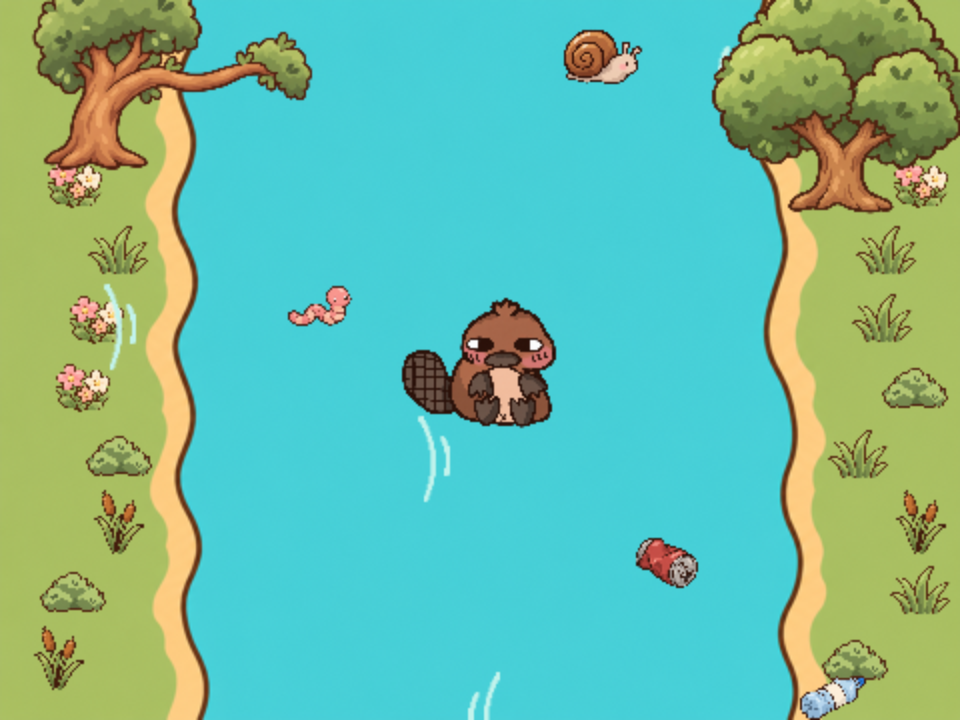

# Lazy Tofu!

Build a scrolling river game with blocks in the Code Club Editor. Help Tofu collect food, dodge rubbish and steer clear of the trees.

This is an unlisted project draft for learners aged 10–14, using [Neil the Seal](https://github.com/raspberrypilearning/editor-neil-the-seal) as the tutorial template.

The starter supplies all seven sprites with empty code areas, plus every costume, backdrop and sound from the supplied Scratch project. Learners code the left-bank foliage, copy its scripts to the existing right-bank sprites, and change the x coordinates before testing.

The tutorial builds a playable game first, then adds the complete sleeping, waking, walking, jumping and splash sequence.

## Resources
See [the English tutorial](en/meta.yml), [starter project](en/code/editor-lazy-tofu-starter), [completed project](en/code/editor-lazy-tofu-complete), [offline resources](en/resources) and [solution](en/solutions).

Authoring decisions, source preservation and verification notes are in [.github/authoring/README.md](.github/authoring/README.md).

## Contributing
See [CONTRIBUTING.md](CONTRIBUTING.md)

## Licence
See [LICENCE.md](LICENCE.md)

## Setting up a Crowdin project

See [CROWDIN.md](CROWDIN.md).
