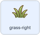

## Grow grass on the right bank

Copy your working grass code to fill the other bank.

## Step 1

Click on **grass-left** and drag both complete scripts onto the existing **grass-right** sprite.

## Step 2

In the `go to x: () y: ()`{:class="block3motion"} block, change `pick random (-220) to (-180)`{:class="block3operators"} to `pick random (180) to (220)`{:class="block3operators"}.

Those positive x positions place the plants on the right bank. Keep y at `-200`{:class="block3motion"}, so they enter from the bottom just like the left-hand plants.



```blocks3
go to x: (pick random (180) to (220)) y: (-200)
```

The wait, costume range and clone movement can all stay the same.

## Now run your code

Click the green flag. Grass should stay on the banks on both sides of the water.
