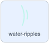

## Add river ripples

Moving ripples will make the water look as though it's flowing too.

## Step 1

Copy both scripts from **grass-left** to **water-ripples**.

## Step 2

In the `when I receive (start)`{:class="block3events"} script, change the random x range to `pick random (-180) to (180)`{:class="block3operators"}. This puts the clones in the water between the banks.

Change the wait to `pick random (1) to (2)`{:class="block3operators"} divided by `speed`{:class="block3variables"}.



```blocks3
when I receive [start v]
hide
go to [back v] layer
forever
+go to x: (pick random (-180) to (180)) y: (-200)
create clone of (myself v)
+wait ((pick random (1) to (2)) / (speed)) seconds
end
```

## Step 3

In the clone script, replace the random costume choice with `water-ripples`{:class="block3looks"}.


```blocks3
when I start as a clone
+switch costume to (water-ripples v)
show
repeat until <(y position) > (180)>
change y by (speed)
end
delete this clone
```

## Now run your code

Click the green flag. Ripples travel through the river at the same speed as the plants on the banks.
