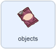

## Float food and rubbish

Give Tofu some things to find in the river.

Copy the generator and movement scripts from `water-ripples`{:class="block3looks"} to `objects`{:class="block3looks"}. Leave the size-changing script behind for now.

## Step 1

The generator already chooses positions in the water and waits between clones. Keep that script as it is.

In the clone movement script, remove the whole `if then else`{:class="block3control"} block that chooses ripple costumes.

Replace it with one costume block that picks a random number from `1` to `6`.



```blocks3
when I start as a clone
switch costume to (pick random (1) to (6))
show
repeat until <(y position) > (180)>
change y by (speed)
end
delete this clone
```

## Step 2

Look at the `Costumes`{:class="block3looks"} tab. The first three costumes are food: shrimp, snail and worm. The next three are rubbish: bottle, can and crisp packet.

Keep them in this order. You'll use the costume number to tell food from rubbish later.

## Now run your code

Click the green flag. Food and rubbish float through the river. They don't affect Tofu yet.
