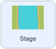
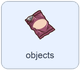

## Set up score and health

Tofu will earn points for food and lose health after collisions.

## Step 1

Click on the **Stage**.

Make two variables, `score`{:class="block3variables"} and `health`{:class="block3variables"}, both **For all sprites**.

## Step 2

In the green-flag script, add `set score to 0`{:class="block3variables"} and `set health to 3`{:class="block3variables"} before `broadcast (start)`{:class="block3events"}.



```blocks3
when green flag clicked
set [speed v] to (1)
+set [score v] to (0)
+set [health v] to (3)
broadcast (start v)
```

## Step 3

Make each food clone check whether Tofu has reached it.

Click on the **objects** sprite and find the movement script.

Inside `repeat until`{:class="block3control"}, check if the sprite is `touching (Tofu)`{:class="block3sensing"}. If it is touching Tofu, check whether `costume number`{:class="block3looks"} is `less than 4`{:class="block3operators"}.

The first three costumes are food. When one touches Tofu, increase the `score`{:class="block3variables"}, start the `Chomp`{:class="block3sound"} sound and `delete this clone`{:class="block3control"}.



```blocks3
when I start as a clone
switch costume to (pick random (1) to (6))
show
repeat until <(y position) > (180)>
change y by (speed)
+if <touching (Tofu v)?> then
if <(costume [number v]) < (4)> then
change [score v] by (5)
start sound (Chomp v)
delete this clone
end
end
end
delete this clone
```

Keep the last `delete this clone`{:class="block3control"} block outside the loop: it still removes objects that reach the top without being collected.

## Now run your code

Click the green flag and swim into a shrimp, snail or worm. The food disappears and your score goes up by `5`{:class="block3variables"}.

Rubbish still floats past for now; you'll make it cost health next.
