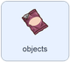

## Dodge the rubbish

Food is worth collecting, but rubbish should cost Tofu some health.

## Step 1

Inside the touching-Tofu check, add an `if then else`{:class="block3control"} block before `delete this clone`{:class="block3control"}.

The first three costumes are food. If `costume number`{:class="block3looks"} is `less than 4`{:class="block3operators"}, add `change score by (5)`{:class="block3variables"} and `start sound (Chomp)`{:class="block3sound"}. Leave `else`{:class="block3control"} empty.



```blocks3
if <touching (Tofu v)?> then
+if <(costume [number v]) < (4)> then
change [score v] by (5)
start sound (Chomp v)
else
end
delete this clone
end
```

## Step 2

In the empty `else`{:class="block3control"} section, add `change health by (-1)`{:class="block3variables"} and `start sound (Scream1)`{:class="block3sound"}.


```blocks3
if <touching (Tofu v)?> then
if <(costume [number v]) < (4)> then
change [score v] by (5)
start sound (Chomp v)
else
+change [health v] by (-1)
+start sound (Scream1 v)
end
delete this clone
end
```

The costume numbers `4`{:class="block3looks"}, `5`{:class="block3looks"} and `6`{:class="block3looks"} all go through `else`{:class="block3control"}, so bottles, cans and crisp packets have the same effect.

## Now run your code

Click the green flag. Collect food to add `5`{:class="block3variables"} to your score. Touch rubbish and health drops by `1`{:class="block3variables"}. Both disappear when touched.
