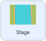

## Let Tofu sleep

The game works. Now add Tofu's sleeping animation on the bank before the swimming begins.

The `start`{:class="block3events"} message already starts the movement, scenery and collision checks. You'll have Tofu send it after waking, instead of the Stage sending it straight away.

## Step 1

Remove `broadcast (start)`{:class="block3events"} from the green-flag script. Keep the variable resets and music loop.



```blocks3
when green flag clicked
set [speed v] to (1)
set [score v] to (0)
set [health v] to (3)
set volume to (10) %
forever
play sound (Flowers Passing By v) until done
end
```

## Step 2

Add a new `when green flag clicked`{:class="block3events"} script.

Set the position to `x: -197, y: 107`{:class="block3motion"}, the size to `23%`{:class="block3looks"}, the direction to `90`{:class="block3motion"} and the rotation style to `left-right`{:class="block3motion"}. `Show`{:class="block3looks"} Tofu and switch to the `tofu-sleeping`{:class="block3looks"} costume.

At the end, add `wait until`{:class="block3control"} with `key (space) pressed?`{:class="block3sensing"}, `go to x: (0) y: (0)`{:class="block3motion"} and `broadcast (start)`{:class="block3events"}.


```blocks3
when green flag clicked
go to x: (-197) y: (107)
set size to (23) %
point in direction (90)
set rotation style [left-right v]
show
switch costume to (tofu-sleeping v)
wait until <key (space v) pressed?>
go to x: (0) y: (0)
broadcast (start v)
```

## Now run your code

Click the green flag. Tofu sleeps on the left bank and the river stays still.

Press the space bar. Tofu appears in the middle and the game begins.
