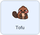

## Waddle towards the river

Make Tofu waddle down the bank before jumping in.

Add these blocks after the wave sequence's `wait (0.5) seconds`{:class="block3control"}, before `go to x: (0) y: (0)`{:class="block3motion"}.

Add `switch costume to (tofu-running)`{:class="block3looks"} and `set rotation style (all around)`{:class="block3motion"} so Tofu can lean from side to side.

Repeat a pair of steps three times: move down, lean left, wait, then move down, lean right and wait again.



```blocks3
wait (0.5) seconds
+switch costume to (tofu-running v)
+set rotation style [all around v]
+repeat (3)
change y by (-10)
turn ccw (15) degrees
wait (0.2) seconds
change y by (-10)
turn cw (15) degrees
wait (0.2) seconds
end
go to x: (0) y: (0)
```

The two turns balance each other, just as the two size changes did in the breathing animation.

## Now run your code

Click the green flag, wait for the four breaths, then press space. Tofu waves, waddles down the bank, then appears in the river to begin swimming.
