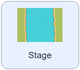

## Choose your river speed

Show `speed`{:class="block3variables"} by ticking its checkbox.

Right-click its display and choose **slider**. Right-click again, choose **change slider range**, and set it from `1`{:class="block3variables"} to `20`{:class="block3variables"}.

Keep the minimum above zero because the clone scripts divide their waits by `speed`{:class="block3variables"}.

Drag the slider to the top of the Stage.

## Now run your code

Click the green flag, wake Tofu and try the slider. The scenery moves faster and clones appear more often as `speed`{:class="block3variables"} increases.

## Make it your own

Choose an idea, change it and test your game:

- Change the food points or starting `health`{:class="block3variables"}.
- Add food or rubbish costumes, then update the random costume range and food-number check.
- Use `tofu-hurt`{:class="block3looks"} after a collision.
- Change the opening animation's waits or glides.
- Keep a best `score`{:class="block3variables"} to beat next time.
