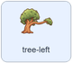

## Grow trees on the left bank

Use clones of **tree-left** to grow a stream of trees.

## Step 1

When the green flag is clicked, hide **tree-left** and place it just below the left bank.

Inside a `forever`{:class="block3control"} loop, create a clone, then `wait 3 seconds`{:class="block3control"} before making the next one.



```blocks3
when green flag clicked
hide
go to x: (-180) y: (-200)
forever
create clone of (myself v)
wait (3) seconds
end
```

## Step 2

Make each clone visible when it starts.


```blocks3
when I start as a clone
show
```

## Now run your code

Click the green flag. A tree appears at the bottom of the left bank.

New trees appear in the same spot every three seconds. Next, you'll move them along the bank.
