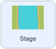
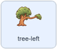

## Move the tree clones

Tofu will stay near the middle of the screen while trees and other objects move past. A shared variable will keep their movement at the same speed.

## Step 1

Click on **Backdrops 1**.

Create a variable called `speed`{:class="block3variables"}, **For all sprites**. Untick its checkbox for now.

Set it to `1`{:class="block3variables"} when the green flag is clicked.

Then make a new message called `start`{:class="block3events"} in a `broadcast ()`{:class="block3events"} block and send it after setting the speed.



```blocks3
when green flag clicked
set [speed v] to (1)
broadcast (start v)
```

## Step 2

Replace `when green flag clicked`{:class="block3events"} with `when I receive (start)`{:class="block3events"} at the top of the Tofu movement loop and the tree-left clone generator.

 

```blocks3
-when green flag clicked
+when I receive [start v]
```

The Stage sets the speed before starting the movement and tree scripts.

## Step 3

Make each tree travel up the screen so it looks like Tofu is moving.

Find the `when I start as a clone`{:class="block3control"} script.

After `show`{:class="block3looks"}, add a `repeat until`{:class="block3control"} loop. Inside it, change y by `speed`{:class="block3variables"}.

Stop repeating when the clone's y position is `greater than 180`{:class="block3operators"}, then delete the clone.


```blocks3
when I start as a clone
show
repeat until <(y position) > (180)>
change y by (speed)
end
delete this clone
```

## Now run your code

Click the green flag and watch the left bank. Trees move from the bottom to the top, then disappear.
