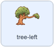

## Vary the trees

Choose different trees and leave different gaps between them.

## Step 1

At the beginning of the clone script, add a `switch costume to ()`{:class="block3looks"} block. Put `pick random (1) to (3)`{:class="block3operators"} inside it to choose one of the three tree costumes.



```blocks3
when I start as a clone
+switch costume to (pick random (1) to (3))
show
repeat until <(y position) > (220)>
change y by (speed)
end
delete this clone
```

## Step 2

In the other script, replace the `3`{:class="block3control"} in the wait with a `() / ()`{:class="block3operators"} block: `pick random (3) to (10)`{:class="block3operators"} divided by `speed`{:class="block3variables"}.


```blocks3
when I receive [start v]
hide
go to x: (-180) y: (-300)
forever
create clone of (myself v)
+wait ((pick random (3) to (10)) / (speed)) seconds
end
```

At `speed = 1`{:class="block3variables"}, trees appear every 3–10 seconds. A higher speed will make them move faster and appear more often, keeping the bank filled as it passes.

## Now run your code

Click the green flag. Watch for all three tree shapes and the different gaps between them.
