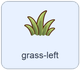

## Grow grass on the left bank

Use the same clone pattern for smaller plants. These will appear more often, at slightly different positions along the bank.

## Step 1

Copy both scripts from `tree-left`{:class="block3looks"} to `grass-left`{:class="block3looks"}.

## Step 2

Edit the `when I receive (start)`{:class="block3events"} script to give each plant a random `x`{:class="block3motion"} position, increase the number of plants and make them appear behind the trees.



```blocks3
when I receive [start v]
hide
go to [back v] layer
forever
go to x: (pick random (-220) to (-180)) y: (-200)
create clone of (myself v)
wait ((0.5) / (speed)) seconds
end
```

## Step 3

The grass sprite has four costumes. In its clone script, change the random costume range to `1–4`{:class="block3operators"}.

Change the y limit to `180`{:class="block3operators"}, so each plant deletes itself when it reaches the top.


```blocks3
when I start as a clone
switch costume to (pick random (1) to (4))
show
repeat until <(y position) > (180)>
change y by (speed)
end
delete this clone
```

## Now run your code

Click the green flag. Tufts, flowers, reeds and bushes move up the left bank, behind the trees.
